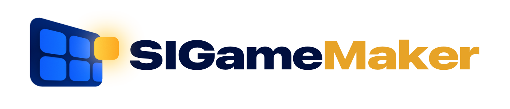

  

# SIGameMaker

**Соберите свою игру. Редактор паков для SIGame прямо в браузере.**

Придумайте темы, добавьте вопросы с фотографиями, музыкой и видео — и скачайте готовый `.siq` для игры с друзьями. Можно начать с чистого листа, доработать существующий пак или собрать новый из двух любимых.

**[Открыть редактор →](https://sigamemaker.karkaplay.workers.dev)** · [Документация](si-studio/README.md) · [Сообщить об ошибке](https://github.com/KarkaPlay/SIGameMaker/issues)

Без установки и регистрации. С русским интерфейсом и открытым исходным кодом.

## От идеи до игры

1. **Создайте игровое поле.** Задайте название пака, раунды, темы и цены вопросов. При необходимости добавьте финал.
2. **Наполните вопросы.** Соберите сценарий из текста, изображений, аудио и видео. Укажите правильный ответ и допустимые формулировки.
3. **Посмотрите, что получилось.** Откройте предпросмотр и проверьте последовательность событий. Редактор подскажет, где не хватает ответа или материалов.
4. **Скачайте пак.** Экспортируйте `.siq` со встроенными медиа и загрузите его в SIGame Online при создании игры.

В главном меню есть пример — с ним можно познакомиться с редактором до создания собственного пака.

## Всё для вашего игрового вечера

### Ваши темы, ваши правила

Создавайте раунды и темы, меняйте стоимость вопросов, добавляйте финал. Всё поле перед глазами: выберите вопрос, и его сценарий откроется рядом. Отмена и повтор помогут спокойно пробовать разные варианты.

### Вопросы, которые интересно раскрывать

Начните с текста, включите музыкальный фрагмент, покажите изображение или видео. Меняйте порядок событий перетаскиванием, настраивайте время и решайте, что показать после ответов игроков. Добавляйте подписи к изображениям, альтернативные ответы и заметки ведущему.

### Знакомые игровые механики

Обычные вопросы, аукционы с открытыми торгами, скрытые ставки всех игроков и «Кот в мешке». Настройки сохраняются в паке, а торги и ответы настоящих игроков проводит SIGame.

### Предпросмотр до начала игры

Посмотрите вопрос на игровом экране и пройдите его события по шагам. Демонстрационные игроки помогают увидеть этапы торгов, передачи кота и проверки ответов. Это наглядный просмотр сценария; окончательно проверить пак стоит в самой SIGame.

### Новый пак из любимых тем

Откройте два пака и перенесите нужные раунды и темы в общую сборку. Переименуйте их, расставьте в нужном порядке и скачайте результат. Исходные файлы останутся без изменений.

## Ваши файлы остаются у вас

Вопросы и медиа обрабатываются в браузере и не отправляются на сервер. Для работы не нужен аккаунт.

Редактор автоматически сохраняет текущий черновик в этом браузере. В медиатеке можно просмотреть фотографии, видео и аудио, а также найти вопросы, в которых они используются.

**Скачивайте `.siq` как резервную копию.** Черновик привязан к браузеру и адресу сайта: он не переносится автоматически на другое устройство и удаляется при очистке данных сайта.

## Совместимость

SIGameMaker экспортирует паки в **SIQ 5** со встроенными изображениями, аудио и видео. Поддерживает импорт обычных вопросов и аукционов SIQ 4 и 5, а также скрытых ставок всех игроков и отдельных типов кота SIQ 5.

Если в паке встречаются неподдерживаемые элементы, редактор покажет причины и доступные действия до замены текущего черновика. Подробности — в [документации по возможностям и ограничениям](si-studio/README.md#сохранение-и-ограничения).

Интерфейс рассчитан на **компьютер или ноутбук**. Мобильная компоновка пока не поддерживается.

## Запуск и участие в проекте

Хотите запустить редактор у себя или поработать над кодом? В документации описаны [локальный запуск и подготовка сайта](si-studio/README.md#запуск), [тесты](si-studio/README.md#проверки) и [устройство проекта](si-studio/README.md#устройство-проекта).

Нашли ошибку или придумали улучшение? [Создайте issue](https://github.com/KarkaPlay/SIGameMaker/issues) и расскажите, что произошло или чего вам не хватает. Предложения и pull request приветствуются.

## Лицензия

Исходный код распространяется по [лицензии MIT](LICENSE). Лицензия включённой библиотеки fflate находится [рядом с её кодом](si-studio/dist/vendor/fflate.LICENSE).
